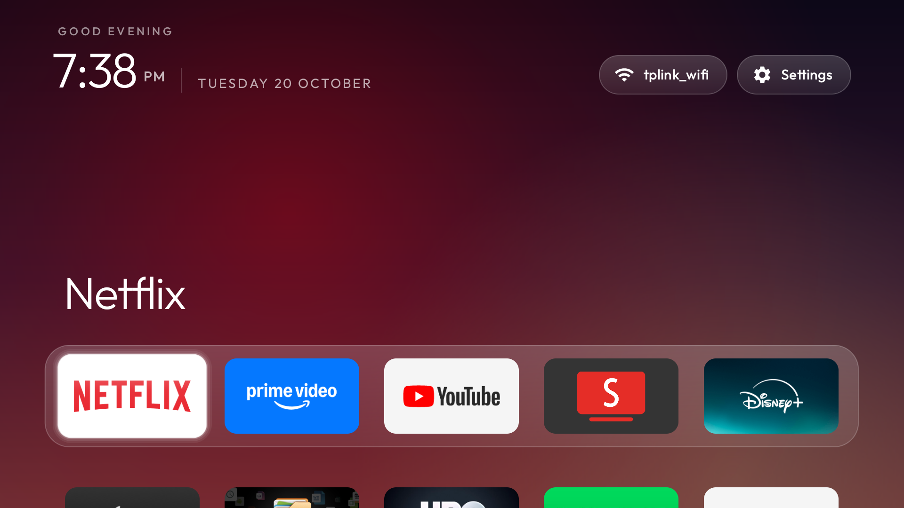

# Skyworth LEAP-S3 (2G/16G) Google TV box: debloat and clean launcher

A complete record of cleaning up a Skyworth LEAP-S3 Google TV box with
[CleanYourTV](https://github.com/Gathin23/cleanyourtv). It covers what was disabled and why, the
problems specific to this box, and the launcher features added in this fork:

- rotating **photo and video backgrounds**
- a **sky backdrop** when the background folder is empty
- **translucent glass** behind the dock and the app rows
- a **5-app dock** with SmartTube, at **6 tiles per row**

Everything was done over Wi-Fi with ADB from a Windows PC. Nothing was uninstalled, and every step
can be undone.



## Contents

- [The device](#the-device)
- [What you need](#what-you-need)
- [1. Connect](#1-connect)
- [2. Back up](#2-back-up)
- [3. Debloat](#3-debloat)
- [4. Ad-blocking DNS](#4-ad-blocking-dns-optional)
- [5. Build the launcher on Windows](#5-build-the-launcher-on-windows)
- [6. Install the launcher](#6-install-the-launcher-and-the-wi-fi-trap)
- [7. Photo and video backgrounds](#7-photo-and-video-backgrounds)
- [8. Look and layout](#8-look-and-layout)
- [9. Close ADB when done](#9-close-adb-when-done)
- [Undo everything](#undo-everything)
- [Known limits](#known-limits)

## The device

| | |
|---|---|
| Model | Skyworth LEAP-S3, 2 GB RAM / 16 GB storage (`ro.product.model` = "4K Google TV Box") |
| Manufacturer | SkyworthDigital (`com.mft.*` / `com.skyworthdigital.*` packages) |
| Chipset | Amlogic (`com.droidlogic.*` packages) |
| OS | Google TV, Android 11 |
| ADB | `ro.adb.secure=1`. Network ADB on port 5555 worked directly, with no Wireless debugging pairing needed |
| Stock home | `com.google.android.apps.tv.launcherx` |
| Factory-disabled packages | none |

## What you need

- A Windows PC on the same network as the box, with:
  - `adb` from the Android platform-tools
  - `git`
  - `ffmpeg`, only if you want to convert videos
- JDK 17 to build the launcher. JDK 11 is too old, and Gradle 8.9 does not run on JDK 23. A zip of
  [Eclipse Temurin 17](https://adoptium.net/) works without installing anything.
- The Android SDK with build-tools 34. Android Studio's default SDK in `%LOCALAPPDATA%\Android\Sdk`
  works, and Gradle downloads platform 34 on its own if it is missing.
- On the box: Settings → System → About → press **Build** 7 times. Then in **Developer options**, turn
  on **USB debugging** and **Network debugging**.

> Clone into a short path such as `C:\cytv`. A long path makes `git clone` fail on Windows with
> "Filename too long".

## 1. Connect

```bash
adb connect <box-ip>:5555
```

The box shows **Allow USB debugging?**. Tick *Always allow from this computer* and press **Allow**.
`adb devices` should then list the box as `device`.

## 2. Back up

Save the state before changing anything:

```bash
adb -s <box-ip>:5555 shell pm list packages -f > backup/packages.txt
adb -s <box-ip>:5555 shell pm list packages -d > backup/disabled.txt
adb -s <box-ip>:5555 shell getprop > backup/getprop.txt
adb -s <box-ip>:5555 shell settings list global > backup/settings-global.txt
adb -s <box-ip>:5555 shell settings list secure > backup/settings-secure.txt
adb -s <box-ip>:5555 shell settings list system > backup/settings-system.txt
```

`backup/` is git-ignored. Keep it to yourself, because it contains your device's serial number and
settings.

> To take screenshots from Windows PowerShell, use
> `adb shell screencap -p /sdcard/s.png` followed by `adb pull /sdcard/s.png`. Piping
> `adb exec-out screencap -p > file.png` through PowerShell corrupts the image.

## 3. Debloat

The full list, with a comment on every line, is in [`debloat.txt`](debloat.txt). Each package is
disabled with `pm disable-user --user 0 <package>`. I disabled them in small batches, one `pm` call
per package, and took a screenshot after each batch.

| Group | Packages | Why |
|---|---|---|
| OEM telemetry and remote management | `com.oemservice` | CPE remote-management agent (`x.cpe.receiver.BootReceiver`) that starts at boot |
| Factory and QA tools | `com.oem.qa`, `com.mft.producttest` | QA tool and Skyworth factory test (KeyStatusCheck and Debug activities) |
| Promoted installs | `android.autoinstalls.config.google.gtvpai` | Silently installs promoted apps |
| Google extras | `com.google.android.feedback`, `com.google.android.apps.nbu.smartconnect.tv` | Feedback reporting, and a mobile-data meter that is useless on Wi-Fi |
| Not needed on a TV box | `com.android.printspooler`, `com.android.camera2` | Printing and camera |
| Owner's choice | `com.google.android.youtube.tvmusic`, `com.google.android.play.games`, `com.google.android.videos` | Not used |
| Stock home (last step) | `com.google.android.tungsten.setupwraith`, `com.google.android.apps.tv.launcherx` | Replaced by the new launcher. See [step 6](#6-install-the-launcher-and-the-wi-fi-trap) |

**Kept on purpose**, because the box needs them:

| Package | What it does |
|---|---|
| `com.mft.rcupair`, `com.google.android.tv.axel` | Remote pairing |
| `com.google.android.tv.dfuservice` | Remote control firmware updates |
| `com.mft.frontpanelledsservice` | Front LED |
| `com.droidlogic.*` | Amlogic platform services |
| Play Store, Play Services, Gboard, TV Settings, Bluetooth | Core system apps |
| Assistant (`katniss`), Chromecast (`mediashell`), Ambient screensaver (`dreamx`) | Kept by the owner's choice |

Also kept: Netflix, Prime Video, YouTube, and every app you installed yourself.

## 4. Ad-blocking DNS (optional)

```bash
adb -s <box-ip>:5555 shell settings put global private_dns_specifier dns.adguard-dns.com
adb -s <box-ip>:5555 shell settings put global private_dns_mode hostname
```

This blocks many in-app ads but **not YouTube ads**. If the resolver ever goes down, the box reports
"no internet". To undo it:

```bash
adb -s <box-ip>:5555 shell settings put global private_dns_mode opportunistic
```

## 5. Build the launcher on Windows

1. Edit [`launcher/app/src/main/res/values/config.xml`](../../launcher/app/src/main/res/values/config.xml).
   This fork's settings are listed in [step 8](#8-look-and-layout).
2. Build:

```powershell
$env:JAVA_HOME = 'C:\cytv\jdk17'      # wherever JDK 17 is unzipped
cd C:\cytv\launcher
.\gradlew.bat testReleaseUnitTest assembleRelease
```

The APK is written to `launcher\app\build\outputs\apk\release\app-release.apk`, about 380 KB. The
first build takes about 5 minutes, and later builds take about 1 minute.

> If a rebuild fails with `classes.dex: The process cannot access the file because it is being used
> by another process`, run `.\gradlew.bat --stop`, delete `app\build\intermediates\dex`, and build again.

## 6. Install the launcher (and the Wi-Fi trap)

```bash
adb -s <box-ip>:5555 push launcher/app/build/outputs/apk/release/app-release.apk /data/local/tmp/tvhome.apk
adb -s <box-ip>:5555 shell pm install -r /data/local/tmp/tvhome.apk
adb -s <box-ip>:5555 shell pm grant com.gathin.tvhome android.permission.ACCESS_FINE_LOCATION
adb -s <box-ip>:5555 shell pm grant com.gathin.tvhome android.permission.READ_EXTERNAL_STORAGE
adb -s <box-ip>:5555 shell cmd package set-home-activity --user 0 com.gathin.tvhome/.MainActivity
adb -s <box-ip>:5555 shell am start -W -n com.gathin.tvhome/.MainActivity
```

Only disable the stock home **after** the new launcher has started.

### The setup wizard owns Home and your Wi-Fi

On this box, `com.google.android.tungsten.setupwraith/.RecoveryActivity` also claims Home, and at a
higher priority than any third-party launcher. If you disable only `launcherx`, pressing Home opens
the setup wizard's recovery screen. The shell is not allowed to disable that single activity:
`SecurityException: Shell cannot change component state`.

Disabling the whole `setupwraith` package fixes Home. But if your Wi-Fi was saved during first
setup, the network **belongs to setupwraith**, and Android deletes it the moment setupwraith is
disabled. The box drops off Wi-Fi, and your ADB connection drops with it.

Check who owns the saved network:

```bash
adb -s <box-ip>:5555 shell "dumpsys wifi | grep -o 'cname=[^ ]*' | sort -u"
```

If you see `cname=com.google.android.tungsten.setupwraith`, fix it before disabling anything:

1. On the box, go to Settings → Network & Internet → your network → **Forget**, then join it again.
2. Reconnect ADB. If the connection shows `offline`, run `adb kill-server`, then connect again.
3. Run the check again. The owner should now be `com.android.tv.settings`.

Then:

```bash
adb -s <box-ip>:5555 shell pm disable-user --user 0 com.google.android.tungsten.setupwraith
adb -s <box-ip>:5555 shell pm disable-user --user 0 com.google.android.apps.tv.launcherx
adb -s <box-ip>:5555 shell cmd package set-home-activity --user 0 com.gathin.tvhome/.MainActivity
adb -s <box-ip>:5555 shell cmd package resolve-activity --brief -c android.intent.category.HOME -a android.intent.action.MAIN
```

The last command must print `com.gathin.tvhome/.MainActivity`. After a reboot, Wi-Fi, the DNS
setting, and the launcher all stayed in place.

## 7. Photo and video backgrounds

This is new in this fork. It lives in [`Slideshow.java`](../../launcher/app/src/main/java/com/gathin/tvhome/Slideshow.java).

Put files in **`/sdcard/Pictures/TvHome`** on the box. No rebuild is needed.

| Folder contents | What Home shows |
|---|---|
| Nothing | The built-in **sky backdrop**: a gradient that follows the time of day, with a warm glow around sunrise and sunset |
| Photos (`.jpg`, `.jpeg`, `.png`, `.webp`) | Full-screen photos in shuffled order, crossfading every `slideshow_seconds` |
| Videos (`.mp4`, `.webm`, `.mkv`) | One video, muted, **looping for as long as you stay on Home**. Each return to Home moves to the next video in the shuffled order |
| A mix | Shuffled together. A photo stays `slideshow_seconds`, and a video loops until you leave Home |

How it behaves:

- **Shuffle order:** every file plays once before any repeats, and the same file never plays twice
  in a row, even when the order reshuffles.
- **Leaving Home:** playback stops and the video decoder is released as soon as an app opens, so it
  costs nothing while you watch something.
- **Darkening:** photos and videos are darkened by `slideshow_dim` so the clock and tiles stay
  readable.
- **Adding and removing files:** the folder is read again before each item. If you empty it, the
  screen goes back to the sky backdrop.
- **Bad files:** a file the box cannot decode is skipped.

Copy files from a PC:

```bash
adb -s <box-ip>:5555 shell mkdir -p /sdcard/Pictures/TvHome
adb -s <box-ip>:5555 push my-wallpaper.mp4 /sdcard/Pictures/TvHome/
```

You can also copy files on the box with a file manager app, for example from a USB drive.

### Convert videos to 1080p first

This box has 2 GB of RAM. Use **1080p H.264** without audio. Most live wallpaper downloads are 4K,
or HEVC/H.265, which may stutter on this box or fail to play.

Scale a 4K file down to 1080p:

```bash
ffmpeg -i input-4k.mp4 -vf "scale=1920:1080:flags=lanczos" -c:v libx264 -profile:v high -level 4.1 -preset slow -crf 20 -pix_fmt yuv420p -an -movflags +faststart output.mp4
```

For a file that is already 1080p H.264, drop the audio without re-encoding, so there is no quality
loss:

```bash
ffmpeg -i input-1080p.mp4 -c:v copy -an -movflags +faststart output.mp4
```

Check what a file contains:

```bash
ffprobe -v error -select_streams v:0 -show_entries stream=codec_name,width,height -of csv=p=0 file.mp4
```

While a video played, the box used about a quarter to a third of its CPU.

### Granting storage access

The launcher reads the folder with `READ_EXTERNAL_STORAGE` on Android 12 and earlier, and with
`READ_MEDIA_IMAGES` and `READ_MEDIA_VIDEO` on Android 13 and later. Both `build-and-install` scripts
grant these. If you install by hand, run the `pm grant` lines in [step 6](#6-install-the-launcher-and-the-wi-fi-trap).

## 8. Look and layout

Settings used on this box, in `config.xml`. Each one can also be set from a theme's `config.json`.
Note that this box blocks shell writes to the launcher's `Android/data` folder, so pushing a theme
does not work here. Change `config.xml` and rebuild instead.

| Key | Value here | Meaning |
|---|---|---|
| `dock_apps` | Netflix, Prime Video, YouTube, SmartTube (`com.teamsmart.videomanager.tv`), Disney+ (`com.disneyplus.ph`) | Dock apps, in order |
| `columns` | `6` | Tiles per row. More columns means smaller tiles; 6 is about 17% smaller than 5 |
| `fill_dock` | `false` | Leave the sixth dock slot empty instead of pulling in a grid app |
| `live_tv_package` | *(empty)* | The box has no tuner |
| `sky_intensity` | `60` | Sky backdrop strength when the background folder is empty |
| `slideshow_dir` | `/sdcard/Pictures/TvHome` | Background photos and videos. Leave it empty to turn the feature off |
| `slideshow_seconds` | `30` | Seconds per photo (5 to 3600) |
| `slideshow_dim` | `35` | Percent darkening of photos and videos (0 to 90) |

### Translucent glass

The dock band and a panel behind the app rows below it use the same frosted glass as the Wi-Fi and
Settings pills: a white gradient from 18% to 8% with a thin white edge. Both are drawn in
[`DockDecoration.java`](../../launcher/app/src/main/java/com/gathin/tvhome/DockDecoration.java).

- **Same width:** the dock band and the rows panel line up, even when the last row is short.
- **Room for zoom:** a focused tile zooms 10%. The glass is widened by that amount, so the first and
  last tiles keep their margin when focused.
- **Full corners:** for the rounded corners not to be cut off, the grid's wrapper reaches 10 dp into
  the side margin and the outer column no longer clips its padding (`activity_main.xml`). The tiles
  themselves did not move.

## 9. Close ADB when done

Network ADB on port 5555 is plaintext. Switch it off:

```bash
adb -s <box-ip>:5555 shell settings put global adb_enabled 0
adb kill-server
```

Then check the port from PowerShell. It should print `False`:

```powershell
(Test-NetConnection <box-ip> -Port 5555).TcpTestSucceeded
```

On the box, open Developer options, check that USB debugging and Network debugging are off, and use
**Revoke USB debugging authorizations**. Everything set up here keeps working with debugging off.

## Undo everything

```bash
# re-enable every package from the list (lines that are not comments)
for p in $(grep -v '^#' examples/skyworth-leap-s3/debloat.txt | awk '{print $1}' | grep .); do
  adb -s <box-ip>:5555 shell pm enable --user 0 $p
done
adb -s <box-ip>:5555 shell cmd package set-home-activity --user 0 com.google.android.apps.tv.launcherx/.home.HomeActivity
adb -s <box-ip>:5555 shell settings put global private_dns_mode opportunistic
adb -s <box-ip>:5555 uninstall com.gathin.tvhome
```

To re-enable a single app, for example the Google TV app:

```bash
adb -s <box-ip>:5555 shell pm enable --user 0 com.google.android.videos
```

## Known limits

- **Ambient screensaver:** Google's Ambient mode cannot be embedded in a launcher. Android only runs
  it as a full-screen screensaver. The background feature uses your own photos and videos instead.
- **Video decoding:** this box may decode the background videos in software. It was smooth at 1080p
  in testing. If menus feel slow, use smaller videos or photos.
- **No pan-and-zoom:** photos do not get the slow pan-and-zoom effect that Ambient mode uses.
- **Sound:** background videos are always muted.
- **Pressing Home on Home:** pressing Home while already on Home keeps the current video. Only
  returning from an app, or waking the box, moves to the next one.

## Credits

[CleanYourTV](https://github.com/Gathin23/cleanyourtv) by Gathin23 (MIT). This fork adds the
LEAP-S3 list, the photo and video background, the sky fallback, and the translucent dock and rows.
